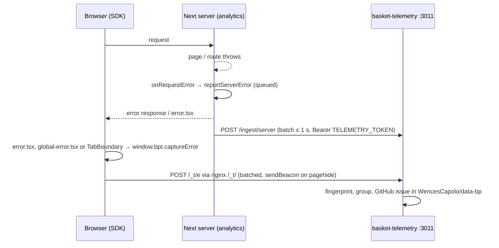

# Telemetry

Analytics reports to [basket-telemetry](https://github.com/WencesCapolo/basket-telemetry), the superadmin panel at `server.basket-app.com` (app key `analytics`). How every app integrates, the `window.bpt` API and the privacy rules: [basket-telemetry docs/sdk.md](https://github.com/WencesCapolo/basket-telemetry/blob/main/docs/sdk.md).

Everything is a no-op until the telemetry service and the env below exist: the SDK turns itself off when `/_t/config` does not answer, and the server reporter sends nothing without `TELEMETRY_TOKEN`.

## What the app sends

**From the browser** (the SDK, `/_t/sdk.js`, same-origin through nginx's `/_t/` proxy): pageviews, heartbeats (active time), clicks, rage/dead clicks, uncaught errors, and PostHog session replay (loaded by the SDK itself; analytics has `replay: yes`). The user is identified server-side from the Better Auth cookie; the app sends no user id.

- `src/app/layout.tsx`: the queueing stub (`window.bpt` before the SDK loads) and `<Script src="/_t/sdk.js" strategy="afterInteractive" />`.
- `src/app/error.tsx` and `src/app/global-error.tsx`: render `src/components/ui/ErrorScreen.tsx` (Spanish fallback) and call `window.bpt?.captureError(error, { boundary, digest })`.
- `src/components/ui/TabBoundary.tsx`: a tab that fails to render is reported with `{ boundary: 'tab' }`.
- `src/types/bpt.d.ts`: the `window.bpt` types, copied from basket-telemetry `src/sdk/sdk.d.ts`.
- Browser source maps are **not** emitted yet (`productionBrowserSourceMaps` is still off), so browser stacks arrive minified.

**From the server** (`src/lib/telemetry.ts`): `reportServerError(err, context)` and `trackServerEvent(name, userId, props)` queue items and POST them in one batch per second to `TELEMETRY_INGEST_URL` (`v: 1`, `events`, `errors`; SPEC §6.2), with a 1.5 s timeout. It never throws and nothing awaits it. Error messages are scrubbed before they leave (`scrubMessage`): it cuts DB errors at `params:` and masks emails, quoted values, JSON objects and numbers, amounts included, so no payment data reaches the ingest; the stack keeps only its frames. `src/instrumentation.ts` `onRequestError` reports every error Next catches in pages, route handlers and the proxy, with `{ method, route, routeType }`.

## Business events

Props are ids, counts and enums only: never emails, names, free text or amounts.

| event | where | props |
|---|---|---|
| `dashboard_viewed` | `src/app/(marco)/{basket,financiero,partidos}/page.tsx`, after `requireDashboard` | `dashboard` (`basket-subs`, `financiero`, `partidos`) |
| `payments_sync_started` | `src/app/api/sync/route.ts` POST, once the Pagos Upload confirm has started | `row_total` (what the browser echoed; `null` if not sent), `trigger` (`analyst` or `token`) |
| `fees_ingested` | `src/app/api/basket/fees/ingest/route.ts` POST, when the confirm is ok | `source_id` (the fee Export source id) |
| `partidos_synced` | `src/app/api/partidos/sync/route.ts` POST, after a successful sync | `count_nacional`, `count_intl`, `duration_ms` |
| `tab_switched` (client) | `src/components/ui/SegmentedTabs.tsx`, used by `TabBar.tsx` and the other dashboards' tab bars; only when the tab changes | `tab` (the tab key) |

`userId` is the Analyst's Better Auth id where there is one, `null` for the sync token and for `partidos_synced`.

## Env

| var | default | note |
|---|---|---|
| `TELEMETRY_INGEST_URL` | `http://127.0.0.1:3011/ingest/server` | localhost only, never through nginx |
| `TELEMETRY_TOKEN` | — | this app's token in basket-telemetry's `INGEST_TOKENS` (`analytics:<token>`). Unset: the server reporter is off. |

The pm2 env of `analytics` also needs `NODE_OPTIONS=--enable-source-maps`, so server stacks arrive resolved.

## Error path

Browser and server errors of analytics reach basket-telemetry, which groups them and opens issues in this repo.

